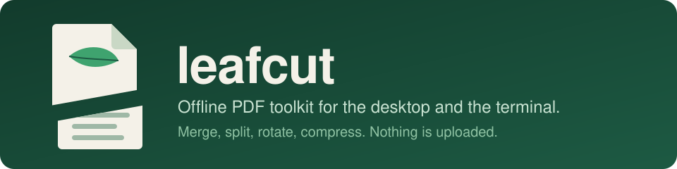
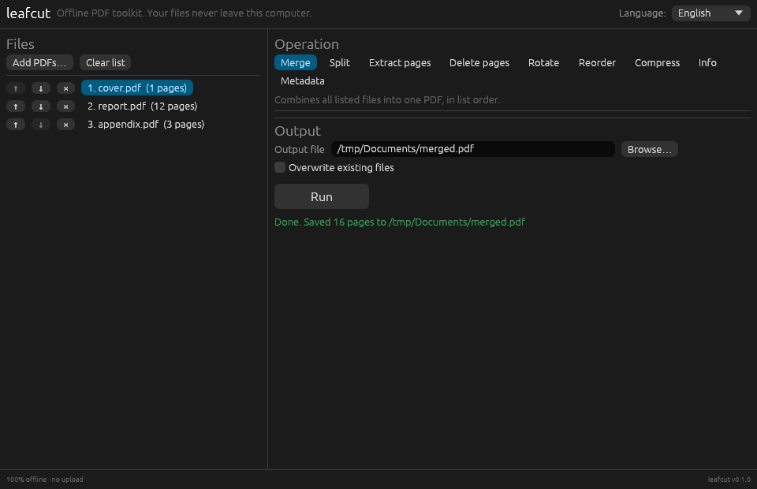
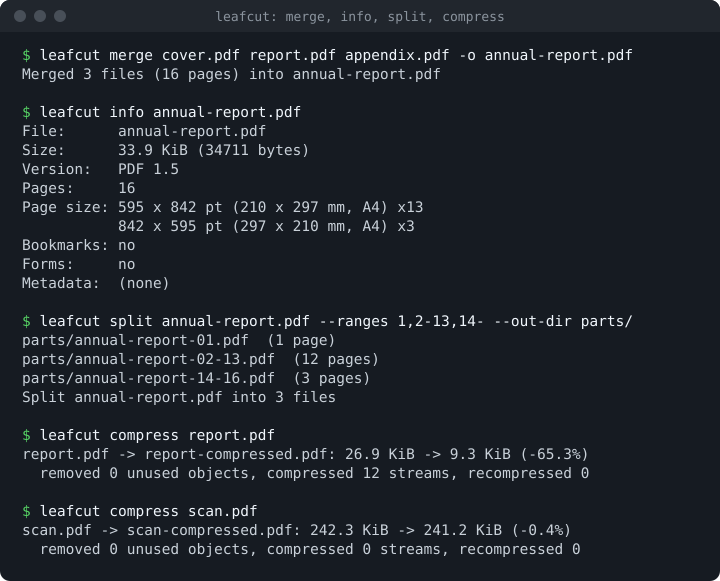
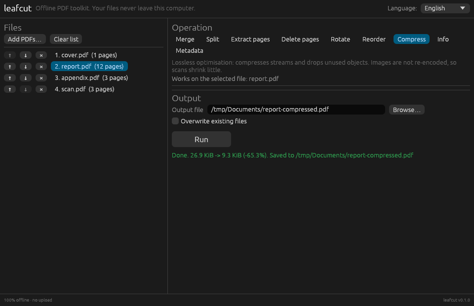
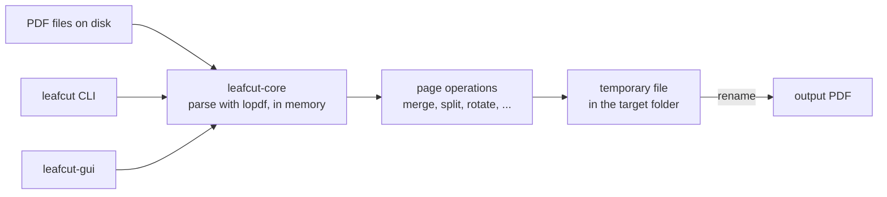

<p align="center">
  
</p>

<p align="center">
  Merge, split, rotate and compress PDFs on your own machine, from a small desktop app or the command line, without uploading anything.
</p>

<p align="center">
  <a href="https://github.com/hytztrk-ux/leafcut/actions/workflows/ci.yml"></a>
  <a href="LICENSE"></a>
  
  
</p>

<p align="center">
  <b>English</b> · <a href="README.tr.md">Türkçe</a>
</p>

---

<p align="center">
  
</p>

<p align="center">
  
</p>

Both pictures are from the release build in this repository, run on sample files. In the terminal
session, `report.pdf` was written without stream compression, which is why it shrinks by 65%;
`scan.pdf` is three pages of JPEG images and barely changes. That gap is typical, see
[Limitations](#limitations).

## Quick start

You need Rust 1.88 or newer.

```sh
git clone https://github.com/hytztrk-ux/leafcut
cd leafcut
cargo build --release

./target/release/leafcut merge a.pdf b.pdf -o both.pdf
./target/release/leafcut info both.pdf
./target/release/leafcut-gui both.pdf
```

On Linux the GUI build needs the usual X11/Wayland and OpenGL development headers; see
[CONTRIBUTING.md](CONTRIBUTING.md#development-setup) for the package list. Only the
command-line tool: `cargo install --path crates/leafcut-cli`.

Prebuilt binaries for Linux, macOS and Windows are on the [Releases page](https://github.com/hytztrk-ux/leafcut/releases).

## What it does

| Operation  | |
|------------|---|
| `merge`    | Combine several PDFs into one, in the order given |
| `split`    | One file per page, per range (`1-3,7,10-`), or every N pages |
| `extract`  | Write selected pages to a new file, in any order |
| `delete`   | Remove pages |
| `rotate`   | Rotate all or selected pages by 90, 180 or 270 degrees |
| `reorder`  | Put pages in a new order, or reverse them |
| `compress` | Lossless optimisation; results vary a lot, see [Limitations](#limitations) |
| `info`     | Page count, page sizes, PDF version and metadata, as text or JSON |
| `meta`     | Set or clear title, author, subject, keywords, creator, producer |

The same operations are in the desktop app. Two programs, one shared library:

- `leafcut` is the command-line tool. Full reference with examples, page-range syntax and exit
  codes: [docs/cli.md](docs/cli.md).
- `leafcut-gui` is a single native window (egui). Add files with the button, by drag and drop, or
  by passing paths on the command line; pick an operation; run. Work happens on a background
  thread. The interface is in English and Turkish and follows the system language.

Some ground rules hold everywhere: inputs are never overwritten unless you ask for it
(`--in-place`), existing outputs are only replaced with `--force` (or the checkbox in the GUI),
and outputs are written to a temporary file and renamed, so a crash does not leave a half-written
PDF.

<p align="center">
  
</p>

## How it works



All PDF logic lives in `leafcut-core`, a pure Rust library built on
[`lopdf`](https://crates.io/crates/lopdf). The CLI and the GUI are thin front ends over it. There
is no networking code in this repository, and no C libraries, Ghostscript or pdfium are involved.

## Compared with the usual options

| | leafcut | Self-hosted PDF web app | Online PDF website |
|---|---|---|---|
| Where files are processed | your machine | a server you run | someone else's server |
| What you need | one executable | a server or container, then a browser | a browser and an upload |
| Works without a network | yes | only if the server is local | no |

## Limitations

leafcut v0.1 is deliberately small. What it does *not* do:

- **Compression is lossless and modest.** `compress` removes unreferenced objects, Flate-compresses
  streams that were stored uncompressed, recompresses existing Flate streams at maximum level when
  that is smaller, and packs objects into compressed object streams (PDF 1.5). It does **not**
  downsample, re-encode or recompress images, and it does not subset or remove fonts. Files from
  tools that write uncompressed or bloated PDFs can shrink a lot (65% for the sample above), while
  PDFs that are already well optimised, or mostly scanned images, typically shrink by a few
  percent or not at all (0.4% for the sample scan). leafcut reports the before and after size.
- **Encrypted (password-protected) PDFs are not supported.** They are detected and rejected with a
  clear error (exit code 3) instead of producing broken output, even when they open without a
  password.
- **Merge keeps pages, not document-level extras.** Page content, resources, annotations and links
  within a page are kept. Bookmarks (outline), interactive form fields (AcroForm), named
  destinations, the structure tree (tagged PDF) and the document metadata of the inputs are not
  carried over into the merged file.
- **Page edits and outlines.** After `delete`, `extract`, `split` or `reorder`, bookmarks that
  pointed to removed pages are left without a target rather than pointing to a wrong page.
- **Metadata.** `meta` edits the document information dictionary. Any XMP metadata stream is
  removed when you set or clear metadata, so viewers do not keep showing stale values. Any edit
  also invalidates digital signatures and PDF/A conformance claims, as with every PDF editor.
- **Damaged files.** leafcut relies on lopdf's parser, which recovers from many but not all broken
  files.
- **Memory.** Documents are processed in memory; very large files (hundreds of MB) need a
  comparable amount of RAM.

## Installing

Building from source as in the [quick start](#quick-start) is the path that works today.

Once release archives exist, each will contain both programs:

- **Windows:** `leafcut-gui.exe` opens the window; `leafcut.exe` is the command-line tool.
- **macOS:** the binaries are not signed yet. On first start, right-click and choose *Open*, or
  run `xattr -d com.apple.quarantine leafcut leafcut-gui`.
- **Linux:** the GUI needs X11 or Wayland and OpenGL. The file dialog uses the XDG desktop portal;
  without one you can still drag and drop files into the window.

### Measured on this build

Release profile (thin LTO, stripped), x86_64 Linux, rustc 1.97.0:

| | |
|---|---|
| `leafcut` binary | 2.0 MiB (2,145,392 bytes) |
| `leafcut-gui` binary | 12.0 MiB (12,614,608 bytes) |
| Peak memory, `leafcut merge` of the three sample files above (16 pages, 37 KiB) | 13.5 MiB |
| Peak memory, `leafcut compress scan.pdf` (242 KiB) | 13.6 MiB |

Memory grows with document size, since documents are held in memory.

## Using the library

```rust
use leafcut_core::{merge_files, PageRanges, Pdf, Rotation};

let mut merged = merge_files(&["a.pdf", "b.pdf"])?;
merged.save("merged.pdf")?;

let mut doc = Pdf::open("scan.pdf")?;
let pages = PageRanges::parse("1-3")?.resolve(doc.page_count())?;
doc.rotate(Some(&pages), Rotation::Cw90)?;
doc.save("scan-rotated.pdf")?;
```

```
crates/
  leafcut-core   library: all PDF logic, typed API, tests
  leafcut-cli    the `leafcut` command-line tool (clap)
  leafcut-gui    the `leafcut-gui` desktop app (egui/eframe, rfd)
```

## Roadmap

Ideas for later versions; contributions welcome:

- Render pages to images (PNG/JPEG) and page thumbnails in the GUI
- Image recompression and downsampling, for real size reduction of scanned documents
- OCR to make scanned PDFs searchable
- Opening encrypted PDFs with a password; adding and removing passwords
- Keeping bookmarks and form fields when merging
- Watermarks, page numbers, stamps
- Images to PDF and PDF to images
- Signed macOS/Windows binaries and package-manager releases (winget, Homebrew, Flatpak)

## Contributing

Bug reports, ideas and pull requests are welcome; please read [CONTRIBUTING.md](CONTRIBUTING.md)
first. Issues and pull requests can be written in English or Turkish.

## License

[MIT](LICENSE) © The leafcut contributors
