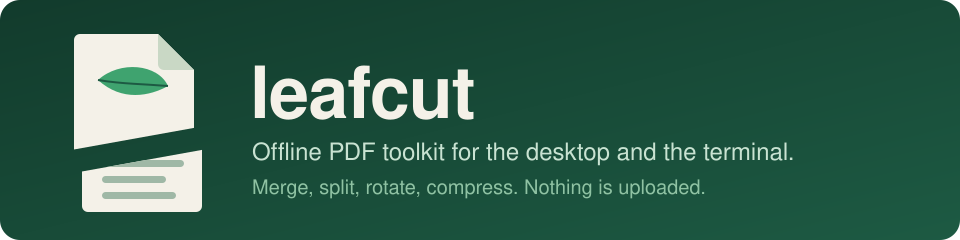
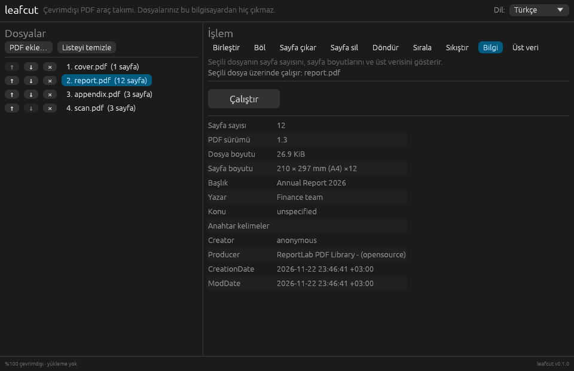
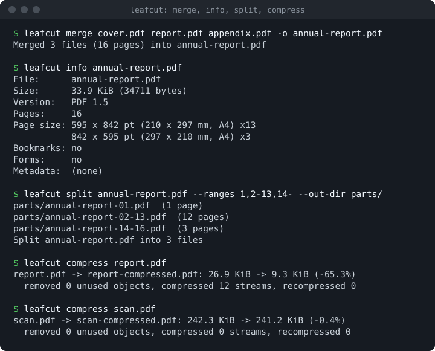
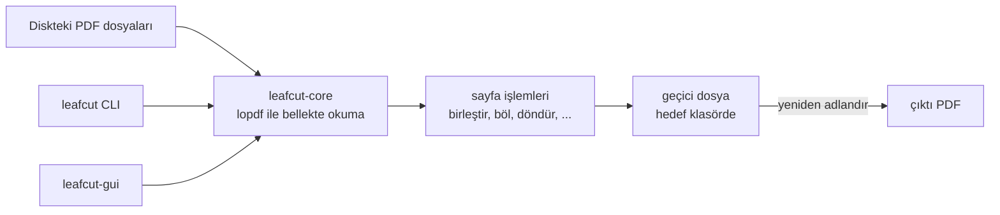

<p align="center">
  
</p>

<p align="center">
  PDF'leri kendi bilgisayarınızda birleştirin, bölün, döndürün ve küçültün. Küçük bir masaüstü uygulamasıyla ya da komut satırından; hiçbir dosya bir yere yüklenmeden.
</p>

<p align="center">
  <a href="https://github.com/hytztrk-ux/leafcut/actions/workflows/ci.yml"></a>
  <a href="LICENSE"></a>
  
  
</p>

<p align="center">
  <a href="README.md">English</a> · <b>Türkçe</b>
</p>

---

<p align="center">
  
</p>

<p align="center">
  
</p>

İki görüntü de bu depodaki sürüm derlemesinin örnek dosyalar üzerinde gerçekten çalıştırılmasıyla
alındı. Arayüz sistem dili Türkçe olduğu için Türkçe açıldı; komut satırı çıktıları şimdilik
yalnızca İngilizce. Terminal oturumundaki `report.pdf` akışları sıkıştırılmadan yazılmış bir dosya,
bu yüzden %65 küçülüyor; `scan.pdf` ise üç sayfalık JPEG görüntülerden oluşuyor ve neredeyse hiç
değişmiyor. Bu fark olağan, ayrıntısı [Sınırlamalar](#sınırlamalar) bölümünde.

## Hızlı başlangıç

Rust 1.88 ya da daha yenisi gerekir.

```sh
git clone https://github.com/hytztrk-ux/leafcut
cd leafcut
cargo build --release

./target/release/leafcut merge a.pdf b.pdf -o ikisi.pdf
./target/release/leafcut info ikisi.pdf
./target/release/leafcut-gui ikisi.pdf
```

Linux'ta arayüzü derlemek için alışıldık X11/Wayland ve OpenGL geliştirme paketleri gerekir; paket
listesi [CONTRIBUTING.md](CONTRIBUTING.md#development-setup) dosyasında. Yalnızca komut satırı
aracı için: `cargo install --path crates/leafcut-cli`.

Linux, macOS ve Windows için hazır derlenmiş dosyalar [Releases sayfasında](https://github.com/hytztrk-ux/leafcut/releases).

## Neler yapar

| İşlem      | |
|------------|---|
| `merge`    | Birden fazla PDF'i verilen sırayla tek dosyada birleştirir |
| `split`    | Her sayfayı, her aralığı (`1-3,7,10-`) ya da her N sayfayı ayrı dosyaya böler |
| `extract`  | Seçilen sayfaları istediğiniz sırayla yeni bir dosyaya yazar |
| `delete`   | Sayfaları siler |
| `rotate`   | Tüm sayfaları ya da seçilenleri 90, 180 veya 270 derece döndürür |
| `reorder`  | Sayfaları yeni bir sıraya koyar ya da tersine çevirir |
| `compress` | Kayıpsız küçültme; sonuç dosyaya göre çok değişir, bkz. [Sınırlamalar](#sınırlamalar) |
| `info`     | Sayfa sayısı, sayfa boyutları, PDF sürümü ve üst veri; metin ya da JSON |
| `meta`     | Başlık, yazar, konu, anahtar kelimeler, oluşturan ve üreten uygulama bilgisini ayarlar ya da siler |

Aynı işlemler masaüstü uygulamasında da var. İki program, ortak bir kütüphane:

- `leafcut` komut satırı aracı. Örnekler, sayfa aralığı yazımı ve çıkış kodlarıyla tam başvuru:
  [docs/cli.tr.md](docs/cli.tr.md).
- `leafcut-gui` tek pencereli yerel bir uygulama (egui). Dosyaları düğmeyle, sürükleyip bırakarak
  ya da komut satırında yollarını vererek ekleyin, işlemi seçin, çalıştırın. İşlem arka planda
  yürür, pencere donmaz. Arayüz Türkçe ve İngilizce; açılışta sistem dilini izler, sağ üst köşeden
  değiştirilebilir.

Her yerde geçerli birkaç kural: siz istemedikçe (`--in-place`) girdi dosyalarının üzerine yazılmaz,
var olan çıktılar yalnızca `--force` ile (arayüzde ilgili kutuyla) değiştirilir, çıktılar önce
geçici bir dosyaya yazılıp sonra yeniden adlandırılır. Bir çökme yarım kalmış bir PDF bırakmaz.

## Nasıl çalışır



Tüm PDF mantığı, [`lopdf`](https://crates.io/crates/lopdf) üzerine kurulu saf Rust kütüphanesi
`leafcut-core` içinde. Komut satırı aracı ve arayüz bunun üzerinde ince katmanlar. Depoda ağ kodu
yok; C kütüphanesi, Ghostscript ya da pdfium kullanılmıyor.

## Alışılmış seçeneklerle karşılaştırma

| | leafcut | Kendi sunucunuzdaki PDF web uygulaması | Çevrimiçi PDF sitesi |
|---|---|---|---|
| Dosyalar nerede işlenir | kendi bilgisayarınızda | sizin çalıştırdığınız sunucuda | başkasının sunucusunda |
| Ne gerekir | tek bir çalıştırılabilir dosya | sunucu ya da konteyner, ardından tarayıcı | tarayıcı ve dosya yükleme |
| Ağ olmadan çalışır mı | evet | yalnızca sunucu yereldeyse | hayır |

## Sınırlamalar

leafcut v0.1 bilerek küçük tutuldu. Neleri *yapmadığı*:

- **Sıkıştırma kayıpsızdır ve etkisi sınırlıdır.** `compress`; hiçbir yerden başvurulmayan
  nesneleri atar, sıkıştırılmadan saklanmış akışları Flate ile sıkıştırır, var olan Flate
  akışlarını daha küçük çıkıyorsa en yüksek seviyede yeniden sıkıştırır ve nesneleri sıkıştırılmış
  nesne akışlarına (PDF 1.5) yerleştirir. Görselleri küçültmez, yeniden kodlamaz; yazı tiplerini de
  ayıklamaz. Sıkıştırmasız ya da şişkin PDF üreten araçlardan çıkan dosyalar ciddi oranda
  küçülebilir (yukarıdaki örnekte %65), ama zaten iyi optimize edilmiş ya da çoğunlukla taranmış
  görüntülerden oluşan PDF'ler genellikle yalnızca yüzde birkaç küçülür, bazen hiç küçülmez
  (örnek taramada %0,4). leafcut önceki ve sonraki boyutu gösterir.
- **Şifreli (parola korumalı) PDF'ler desteklenmez.** Bozuk çıktı üretmek yerine algılanır ve açık
  bir hata mesajıyla reddedilir (çıkış kodu 3); parolasız açılabilen şifreli dosyalar da buna
  dahildir.
- **Birleştirme sayfaları korur, belge düzeyindeki ekleri değil.** Sayfa içerikleri, kaynakları,
  açıklamalar (annotation) ve sayfa içi bağlantılar korunur. Girdilerin yer imleri (outline),
  etkileşimli form alanları (AcroForm), adlandırılmış hedefleri, yapı ağacı (etiketli PDF) ve
  belge üst verisi birleştirilen dosyaya aktarılmaz.
- **Sayfa düzenlemeleri ve yer imleri.** `delete`, `extract`, `split` ya da `reorder` sonrasında,
  silinen sayfaları gösteren yer imleri yanlış bir sayfayı göstermek yerine hedefsiz kalır.
- **Üst veri.** `meta`, belge bilgi sözlüğünü (Info) düzenler. Üst veriyi ayarladığınızda ya da
  sildiğinizde, görüntüleyiciler eski değerleri göstermeye devam etmesin diye varsa XMP üst veri
  akışı da kaldırılır. Her PDF düzenleyicide olduğu gibi, herhangi bir düzenleme dijital imzaları
  ve PDF/A uygunluk beyanlarını geçersiz kılar.
- **Bozuk dosyalar.** leafcut, lopdf'in ayrıştırıcısına dayanır; bu ayrıştırıcı bozuk dosyaların
  çoğunu kurtarabilir ama hepsini değil.
- **Bellek.** Belgeler bellekte işlenir; çok büyük dosyalar (yüzlerce MB) benzer miktarda RAM
  gerektirir.

## Kurulum

Bugün kesin çalışan yol, [hızlı başlangıçtaki](#hızlı-başlangıç) gibi kaynak koddan derlemek.

Sürüm arşivleri yayımlandığında her birinde iki program da bulunacak:

- **Windows:** `leafcut-gui.exe` pencereyi açar; `leafcut.exe` komut satırı aracıdır.
- **macOS:** Programlar henüz imzalı değil. İlk açılışta sağ tıklayıp *Aç* deyin ya da
  `xattr -d com.apple.quarantine leafcut leafcut-gui` komutunu çalıştırın.
- **Linux:** Arayüz için X11 ya da Wayland ve OpenGL gerekir. Dosya seçme penceresi XDG masaüstü
  portalını kullanır; portal yoksa dosyaları pencereye sürükleyip bırakabilirsiniz.

### Bu derlemede ölçülenler

Sürüm profili (thin LTO, strip edilmiş), x86_64 Linux, rustc 1.97.0:

| | |
|---|---|
| `leafcut` dosya boyutu | 2,0 MiB (2.145.392 bayt) |
| `leafcut-gui` dosya boyutu | 12,0 MiB (12.614.608 bayt) |
| En yüksek bellek kullanımı, yukarıdaki üç örnek dosyanın `leafcut merge` ile birleştirilmesi (16 sayfa, 37 KiB) | 13,5 MiB |
| En yüksek bellek kullanımı, `leafcut compress scan.pdf` (242 KiB) | 13,6 MiB |

Belgeler bellekte tutulduğu için bellek kullanımı dosya boyutuyla artar.

## Kütüphane olarak kullanım

```rust
use leafcut_core::{merge_files, PageRanges, Pdf, Rotation};

let mut merged = merge_files(&["a.pdf", "b.pdf"])?;
merged.save("merged.pdf")?;

let mut doc = Pdf::open("scan.pdf")?;
let pages = PageRanges::parse("1-3")?.resolve(doc.page_count())?;
doc.rotate(Some(&pages), Rotation::Cw90)?;
doc.save("scan-rotated.pdf")?;
```

```
crates/
  leafcut-core   kütüphane: tüm PDF mantığı, tipli API, testler
  leafcut-cli    `leafcut` komut satırı aracı (clap)
  leafcut-gui    `leafcut-gui` masaüstü uygulaması (egui/eframe, rfd)
```

## Yol haritası

Sonraki sürümler için fikirler; katkılara açığız:

- Sayfaları görüntüye (PNG/JPEG) dönüştürme ve arayüzde sayfa küçük resimleri
- Taranmış belgelerde gerçek boyut kazancı için görsel yeniden sıkıştırma ve çözünürlük düşürme
- Taranmış PDF'leri aranabilir yapmak için OCR
- Şifreli PDF'leri parolayla açma; parola ekleme ve kaldırma
- Birleştirirken yer imlerini ve form alanlarını koruma
- Filigran, sayfa numarası, damga
- Görüntüden PDF'e ve PDF'ten görüntüye dönüştürme
- İmzalı macOS/Windows dosyaları ve paket yöneticisi dağıtımları (winget, Homebrew, Flatpak)

## Katkıda bulunma

Hata bildirimlerine, fikirlere ve pull request'lere açığız; lütfen önce
[CONTRIBUTING.md](CONTRIBUTING.md) dosyasını okuyun. Issue ve pull request'leri Türkçe ya da
İngilizce yazabilirsiniz.

## Lisans

[MIT](LICENSE) © The leafcut contributors
